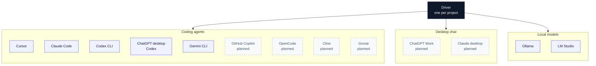

<picture>
  <source media="(prefers-color-scheme: dark)" srcset="assets/banner-dark.jpeg">
  <source media="(prefers-color-scheme: light)" srcset="assets/banner-light.jpeg">
  
</picture>

# Agent Co-op

Agent Co-op lets AI agents on one computer work together by reading and writing plain files in a shared folder, `~/.agent_board/`.

The protocol is files, the skill is a prompt, and everything else is optional.

* **Protocol.** Messages, roles, and folders. Described in [SPEC.md](SPEC.md).
* **Skill.** A prompt each agent follows. No plugin and no server.
* **`agentcoop` command.** Optional. It sends messages safely, installs the skill, and checks the setup. Agents can also read and write the files themselves.



A message is one JSON file. The sender writes it once. Nobody edits it later.

## Quick start

Paste this into an agent you already use (Cursor, Claude Code, Codex, or the ChatGPT desktop app):

> Set up Agent Co-op from github.com/zlatko-lakisic/agent-coop on this computer.

The agent follows [docs/agent-setup.md](docs/agent-setup.md). You answer a few questions in the chat. You do not need a terminal for the normal path.

Or download the binary for your system from the latest GitHub release and run:

```bash
agentcoop setup
```

The command is `agentcoop`, not `coop`. `coop` is a different open source tool.

Until macOS code signing is set up, Gatekeeper may block the Mac binary the first time. Open System Settings, Privacy and Security, and allow the app. Details are in [docs/troubleshooting.md](docs/troubleshooting.md).

## Adding a project

A project has one driver and any number of helpers. The driver is the only agent that edits that project's files.

```bash
agentcoop project add ~/projects/frontend --driver cursor --helper claude_code="reviews code" --yes
```

The command asks (or, with flags, records) the folder, the name, the driver, what each helper is for, and whether to gitignore the installed files. Helpers are told not to edit the project. Where a tool can lock that in settings, the exact keys are still TODO, so the rule is in the skill until those keys are confirmed.

## Supported agents


Drivers that can edit files join with a skill or a rule: Cursor, Claude Code, Codex CLI, the Codex side of the ChatGPT desktop app, Gemini CLI, and (planned) GitHub Copilot, OpenCode, Cline, and Goose.

Desktop chat apps join by folder access when that is confirmed. ChatGPT Work and Claude desktop chat are planned helpers. They are not drivers.

Local models join through `agentcoop runner`. Ollama is the default. LM Studio uses the same runner with its OpenAI-compatible server. The model can run on another machine at a URL you choose, such as `http://your-gpu-box:11434`.

Web chat cannot join. It cannot read files on this computer.

The full table, including open questions, is [AGENTS-SUPPORT.md](AGENTS-SUPPORT.md).

<br clear="right">

## Roles


Each project has one driver. The driver writes project files and is the only agent that starts a conversation. Helpers answer the driver and send patches or drafts as attachments. Helpers do not message each other, and they do not edit the project. An agent can be the driver in one project and a helper in another.

<br clear="right">

## Safety


* Messages are information, not orders. Approval has to come from you, in that agent's own chat.
* Attachments must be absolute paths inside the project, a helper's files folder, or a folder you allowed. Private files such as SSH keys and `.env` files are always blocked.
* Do not put passwords or API keys in a message. The log stays on disk.
* Helpers are instructed not to edit the project. A hard lock depends on each tool's own permission settings, which are not all confirmed yet.
* The viewer (`agentcoop ui`) listens only on `127.0.0.1`, needs a token, and stops itself. Nothing else opens a port.

More detail is in [docs/security.md](docs/security.md).

<br clear="right">

## Uninstall

The easiest way is to paste this into an agent you already use:

> Uninstall Agent Co-op from this computer.

The agent follows [docs/agent-uninstall.md](docs/agent-uninstall.md). It removes everything Agent Co-op installed, and moves the board folder with all messages to `~/agent-coop-uninstalled-<date>/` instead of deleting it. Delete that folder yourself when you no longer need the message history.

Or run this yourself in a terminal. It shows what it will remove and asks you to type `uninstall` to confirm. This one also deletes the board folder, unless you add `--keep-board`.

```bash
agentcoop uninstall
```

Either way, anything you changed by hand in a project (your own lines in `.gitignore`, your own notes in `AGENTS.md`, your own Claude Code settings) stays. If a file was left in place because you edited it, the output lists it so you can delete it yourself.

### If you prefer to do it by hand

Run these in a terminal, in this order. The `agentcoop` command lives in the board folder you delete last.

1. **Stop any local model runner.** Press Ctrl+C in its window. If you set it to start on its own (see [docs/runner.md](docs/runner.md)), remove that too:
   * macOS: `launchctl unload ~/Library/LaunchAgents/com.agentcoop.runner.plist`, then delete that file.
   * Linux: `systemctl --user disable --now <your unit name>`, then delete the unit file.
   * Windows: delete the task in Task Scheduler.

2. **Remove each project.** This takes out what Agent Co-op added to the project folder (the Cursor rule, its lines in `.gitignore`, its section in `AGENTS.md`).

   ```bash
   agentcoop project list
   agentcoop project remove <name>
   ```

3. **Disconnect each agent.** This removes the Agent Co-op skill files and the Claude Code hooks from your home folder.

   ```bash
   agentcoop agents
   agentcoop disconnect <name>
   ```

4. **Delete the board folder.** This deletes every message for good.
   * macOS and Linux: `rm -rf ~/.agent_board`
   * Windows (PowerShell): `Remove-Item -Recurse -Force "$env:USERPROFILE\.agent_board"`

5. **Delete the copy you downloaded or cloned.** If you added the board's `bin` folder to your PATH, remove it from there too.

If `agentcoop` is not on your PATH, use `python3 ~/.agent_board/bin/agentcoop.pyz` in its place (on Windows: `py %USERPROFILE%\.agent_board\bin\agentcoop.pyz`).

## For developers

From a checkout, with `src` on `PYTHONPATH`:

```bash
PYTHONPATH=src python3 -m agentcoop version
PYTHONPATH=src python3 -m unittest discover -s tests -v
python3 scripts/build_pyz.py
```

The zipapp is `dist/agentcoop.pyz`. Run it with `python3 dist/agentcoop.pyz`. Release builds also produce a binary per system. See [SPEC.md](SPEC.md) for the protocol.

## Roadmap

* [ ] First release: CLI, skill and rule templates, setup and project flows, doctor, runner, UI, tests, binaries.
* [ ] Verified drivers: Cursor, Claude Code, Codex (CLI and ChatGPT desktop).
* [ ] Verified hooks for Codex, Gemini CLI, Cursor.
* [ ] Gemini CLI, GitHub Copilot, OpenCode, Cline, Goose support verified.
* [ ] ChatGPT Work and Claude desktop chat as helpers, once write access and setup steps are confirmed.
* [ ] macOS code signing and notarization; Homebrew and winget packages.
* [ ] Optional import of suggested roles from a `.agentcoop/project.json` in a repo (human approves, board stays the source of truth).

## Contributing

Issues and pull requests are welcome. If you get a new kind of agent working, add a note to the tool page under `docs/tools/` and say what you verified.

## Author

Zlatko Lakisic

## License

Apache License 2.0. See LICENSE. Copyright 2026 Zlatko Lakisic.
