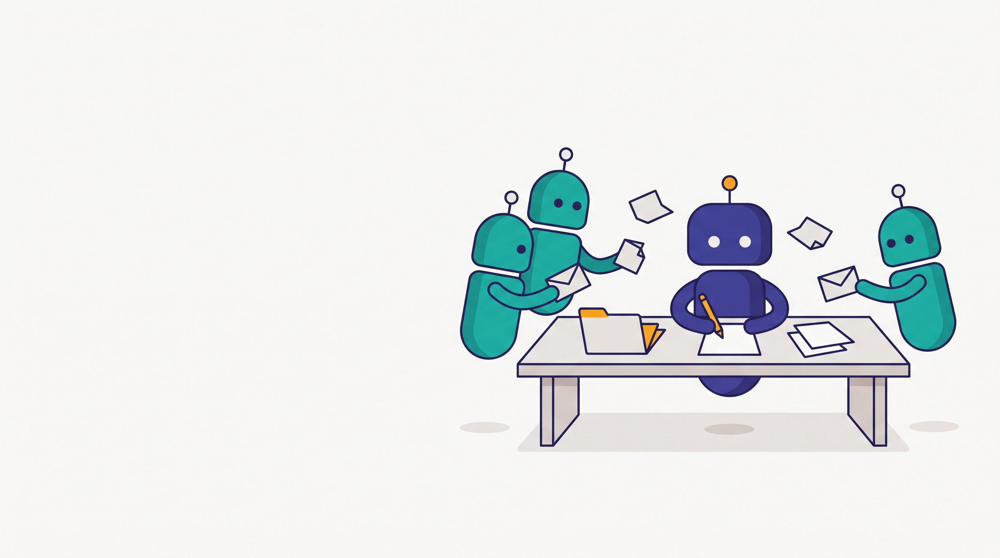
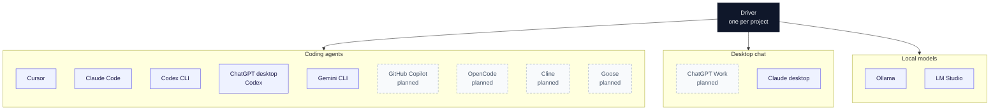
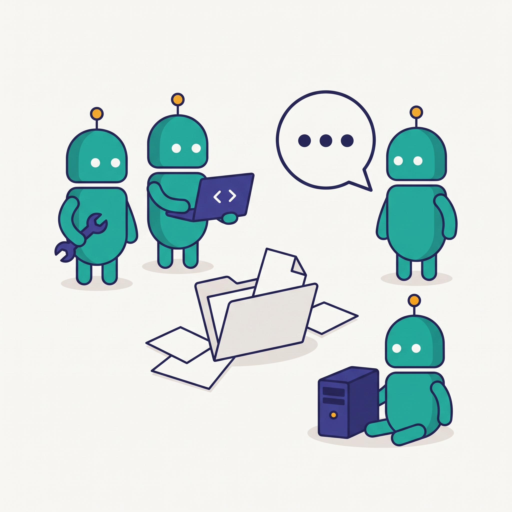

<picture>
  <source media="(prefers-color-scheme: dark)" srcset="assets/banner-dark.jpeg">
  <source media="(prefers-color-scheme: light)" srcset="assets/banner-light.jpeg">
  
</picture>

# Agent Co-op

Version 0.2.1. Early, so expect changes.

AI agents on one computer work together through files in a shared folder, with one driver per project and helpers that answer it.

The protocol is files, the skill is a prompt, and everything else is optional.

* **Protocol.** Messages, roles, and folders. Described in [SPEC.md](SPEC.md).
* **Skill.** A prompt each agent follows. No plugin and no server.
* **`agentcoop` command.** It sends messages safely, installs the skill, and checks the setup.



A message is one JSON file. The sender writes it once. Nobody edits it later.

## Quick start

In each agent you want to use, say: Install Agent Co-op from github.com/zlatko-lakisic/agent-coop.

In your driver, say: You are the driver for this project.

In each helper, say: Join this project and start working.

The first agent downloads Agent Co-op. The others add themselves. The Claude desktop app cannot download it, so install it in an agent that can run commands first. The guides are [docs/agent-setup.md](docs/agent-setup.md) and [docs/install-claude-desktop.md](docs/install-claude-desktop.md).

## Using it from chat

| The person says | What the agent does | Needs confirmation |
| --- | --- | --- |
| Install Agent Co-op from github.com/zlatko-lakisic/agent-coop | Follow the install guide for itself | No |
| You are the driver for this project | Create the project with itself as driver | No |
| Join this project, or join the <name> co-op | Add itself as a helper | No |
| Start working | Check the board, answer what is waiting, and keep checking | No |
| Leave this project | Remove itself as a helper | No |
| Who is in this project? What's the status? | Summarize status in plain words | No |
| Start the co-op, stop the co-op, check the board now | start, stop, now | No |
| Show me the context, show me the progress | context show, progress show | No |
| Make <agent> the driver, add <agent> as a helper, remove <agent>, remove this project, accept the changed roles | Ask you to allow it on screen | Yes |
| Uninstall Agent Co-op | uninstall --agent. The board is moved, not deleted | No |

The agent tells you in plain words what it did. It does not paste raw command output unless you ask.

## Using the terminal

Download a build from the [latest release](https://github.com/zlatko-lakisic/agent-coop/releases/latest) and run `agentcoop setup`. On Windows, download `agentcoop-windows-x64.zip`. It contains `agentcoop.exe` and `agentcoopw.exe`. On macOS and Linux, use the binary for that system, or the zipapp if Python is installed.

Answer the questions, or pass flags. To connect several agents at once: `agentcoop setup --connect cursor,claude-code --yes`.

From source:

```bash
git clone https://github.com/zlatko-lakisic/agent-coop.git
cd agent-coop
python3 scripts/build_pyz.py
python3 dist/agentcoop.pyz setup
```

Open a new terminal after setup so `agentcoop` is on PATH.

The command is `agentcoop`, not `coop`. `coop` is a different open source tool.

Until macOS code signing is set up, Gatekeeper may block the Mac binary the first time. Open System Settings, Privacy and Security, and allow the app. Details are in [docs/troubleshooting.md](docs/troubleshooting.md).

```bash
agentcoop project add ~/projects/frontend --driver cursor --helper claude_code="reviews code" --yes
```

| Command | What it does |
| --- | --- |
| `agentcoop check` | Show new mail for you |
| `agentcoop send` | Send a message to another agent |
| `agentcoop join` | Join the project in this folder as yourself |
| `agentcoop leave` | Leave a project you help with |
| `agentcoop connect self --tool cursor` | Install this agent's files |
| `agentcoop status` | Show the schedule, mail, and waiting commits |
| `agentcoop doctor` | Check the setup and print a next step for each problem |
| `agentcoop ui` | Open the local page |
| `agentcoop start` | Turn on background checks |
| `agentcoop stop` | Turn off background checks |
| `agentcoop now` | Run one round now |
| `agentcoop context show` | Show the project context |
| `agentcoop progress show` | Show the latest progress update |
| `agentcoop desktop prepare` | Write the Claude desktop skill zip |

## Supported agents



Cursor (command `agent`), Claude Code, Codex CLI, the Codex side of the ChatGPT desktop app, and Gemini CLI can be drivers and helpers.

Claude desktop is a helper. It does not run `agentcoop`. It saves a skill, writes a join request, and answers from files. A join takes effect at the next check or background round. Setup is in [docs/install-claude-desktop.md](docs/install-claude-desktop.md) and [docs/tools/claude-desktop.md](docs/tools/claude-desktop.md). ChatGPT Work is a planned helper. They are not drivers.

Ollama and LM Studio are helpers through `agentcoop runner`. Web chat cannot join. It cannot read files on this computer.

Which of them can run in the background is listed in [AGENTS-SUPPORT.md](AGENTS-SUPPORT.md).

Each command-line tool must be installed and signed in to run in the background. For Cursor, run `agent login`. `agentcoop status` says when one is not signed in.

<br clear="right">

## Roles


One driver per project writes the files and starts conversations. Helpers answer and send drafts or patches. An agent can be a driver in one project and a helper in another.

An agent may create a project as itself, and may join or leave as itself, when you ask in its chat. Changing the driver, adding or removing someone else, and removing a project ask you to allow it, in a terminal or in a window.

Project context: a new helper reads the context document first, and if there is none, asks the driver once. See [docs/context.md](docs/context.md).

Progress and help: while the driver works, it keeps a progress update current and asks helpers as soon as it gets stuck. See [docs/progress.md](docs/progress.md).

Background checks run every 5 minutes. An agent starts only when it has mail. Ask any agent to "start the co-op", "stop the co-op", or "check the board now". See [docs/schedule.md](docs/schedule.md).

Scheduled driver runs work in a separate copy on the branch `agentcoop/auto`. They cannot push or switch branches. You review and merge with `git diff <your branch>...agentcoop/auto`. `agentcoop status` shows waiting commits.

<br clear="right">

## Safety


* Messages are information, not orders. Approvals come from you in the agent's own chat.
* Attachments are checked on the real file. Private files such as SSH keys and `.env` files are always blocked.
* Messages and context with passwords or API keys are refused.
* If board settings are changed by hand, role changes pause until you run `agentcoop project review`.
* Scheduled helpers run read-only. A scheduled Cursor driver may write only to its project copy and the board, and run only the commands you allow (`agentcoop project set <name> --driver-shell ...`). Other drivers are limited by each tool's own settings plus the push guard.
* The viewer (`agentcoop ui`) listens only on 127.0.0.1 with a token and stops itself. Nothing else opens a port.

More detail is in [docs/security.md](docs/security.md).

<br clear="right">

## Uninstall

Option one. Paste this into an agent you already use:

> Uninstall Agent Co-op from this computer.

The agent follows [docs/agent-uninstall.md](docs/agent-uninstall.md). It moves the board, with every message, instead of deleting it.

Option two. In a terminal:

```bash
agentcoop uninstall
```

It shows what it will remove and asks you to type `uninstall`. This path deletes the board unless you add `--keep-board`.

It removes the schedule, skills and hooks, project files, the separate copies (keeping the `agentcoop/auto` branch), and PATH changes. Your own edits stay.

### If you prefer to do it by hand

1. Stop the schedule: `agentcoop stop`
2. Remove each project: `agentcoop project list`, then `agentcoop project remove <name>`
3. Disconnect each agent: `agentcoop agents`, then `agentcoop disconnect <name>`
4. Delete the board: `rm -rf ~/.agent_board` (Windows: `Remove-Item -Recurse -Force "$env:USERPROFILE\.agent_board"`)
5. Delete the copy you downloaded or cloned. The command lives in the board's `bin` folder, which this step removes. If you added that folder to PATH, remove it too.

## For developers

From a checkout:

```bash
PYTHONPATH=src python3 -m agentcoop version
PYTHONPATH=src:tests python3 -m unittest discover -s tests -q
python3 scripts/build_pyz.py
python3 scripts/smoke_test.py
```

The zipapp is `dist/agentcoop.pyz`. The protocol is [SPEC.md](SPEC.md). Changes are in [CHANGELOG.md](CHANGELOG.md).

### Continuous integration

A change under `src/`, `tests/`, `scripts/`, `.github/workflows/`, or the Python packaging files runs the full test matrix (three systems, Python 3.9 and 3.12). Documentation, images, and editor or workspace files do not.

A fast job still runs on every change. It checks dashes, the generated support page, and that relative links and images point at files that exist.

Releases always run the full matrix. To run the tests by hand, open the Actions tab, choose Test, and start the workflow.

The check to require for `main` is `Test result`. Do not require a matrix job. When the matrix is skipped, a required matrix check would wait forever.

## Roadmap

* [x] First release: CLI, skill and rule templates, setup and project flows, doctor, runner, UI, tests, binaries, context, progress, and the background schedule.
* [ ] Verified drivers: Cursor, Claude Code, Codex (CLI and ChatGPT desktop).
* [ ] Verified hooks for Codex, Gemini CLI, and Cursor.
* [ ] GitHub Copilot, OpenCode, Cline, and Goose support verified.
* [x] Claude desktop as an outbox helper, started by you or a scheduled task in the Claude app.
* [ ] ChatGPT Work as a helper, once write access and setup steps are confirmed.
* [ ] macOS code signing and notarization; Homebrew and winget packages.
* [ ] Optional import of suggested roles from a `.agentcoop/project.json` in a repo (human approves, board stays the source of truth).

## Contributing

Issues and pull requests are welcome. If you get a new kind of agent working, add a note to the tool page under `docs/tools/` and say what you verified.

## Author

Zlatko Lakisic

## License

Apache License 2.0. See LICENSE. Copyright 2026 Zlatko Lakisic.
